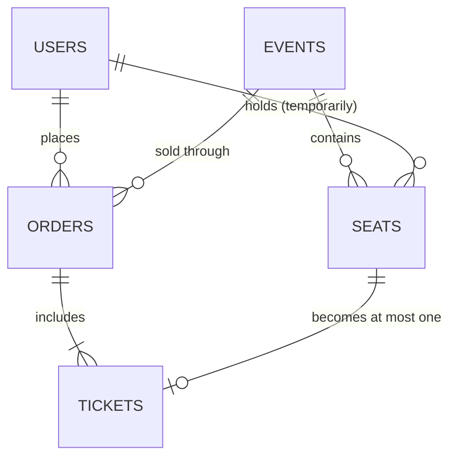
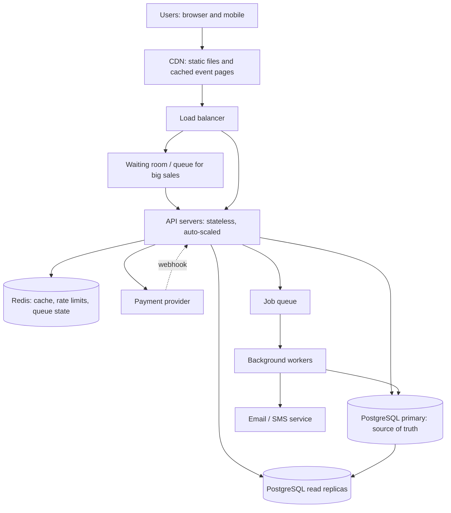

# TicketHub: System Design

TicketHub is a website that sells tickets for concerts and events. This document follows the six-part framework: requirements, estimates, API, data model, architecture, trade-offs.

**Given facts**

- 2,000,000 registered users
- Normal day: 50,000 visitors, 10 page views each, 5,000 tickets sold
- Big sale: 200,000 people try to buy 20,000 seats within the first 10 minutes

---

## 1. Requirements

### Functional

1. A user can register, log in and log out.
2. A user can browse and search upcoming events (by name, date, venue).
3. A user can view an event's details and its seat map with the status of each seat (available / held / sold).
4. A user can **hold** up to 4 seats for 10 minutes while they pay.
5. A user can pay for held seats; on success the seats become tickets.
6. A user can view their tickets and past orders.
7. Holds that are not paid expire automatically and the seats go back on sale.
8. An organiser can create an event and set its seats, prices and on-sale time.

### Non-functional

| Quality | Requirement | Why it matters |
|---|---|---|
| **Speed** | Browsing pages respond in under 300 ms (95th percentile). Holding a seat responds in under 1 second, even during a big sale. | Slow pages during a sale make people refresh, which makes the load worse. |
| **Correctness** | A seat is never sold to two people. A customer is never charged for a seat they do not receive. Payments are never charged twice. | Double-booking is the worst failure: two people arrive with the same ticket. |
| **Fairness** | During a big sale, people are served in the order they arrived. Bots and people opening many tabs cannot jump the line. One person is limited to 4 tickets per event. | Buyers lose trust if the fastest script always wins. |
| **Availability** | Browsing stays up even if payment or email is slow. Target 99.9% uptime, and 99.99% in the sale window. | A crash during a sale is highly visible. |
| **Scalability** | Handles about 500x normal traffic for short bursts without manual intervention. | See the estimates below. |
| **Security** | Passwords are hashed. Card details never touch our servers (the payment provider handles them). All traffic uses HTTPS. | Legal and trust reasons. |

---

## 2. Estimates

### Normal day

- Page views: 50,000 visitors x 10 pages = **500,000 page views/day**
- Average rate: 500,000 / 86,400 seconds is about **6 requests/second**
- Real traffic is not flat. Assume the busiest hour is about 10x the average, so the normal **peak is about 60 requests/second**.
- Tickets sold: 5,000/day = about 0.06 tickets/second on average (a few per second at the busiest moment).
- Storage: 5,000 tickets/day x about 1 KB = about 5 MB/day, or about 2 GB/year. This is small.

### Big sale (popular concert goes on sale)

- 200,000 buyers in 10 minutes (600 seconds) = about **333 new users/second**.
- Assume each buyer sends about 10 requests during the window (open the event page, load the seat map a few times, one or more hold attempts, pay, view tickets): 200,000 x 10 = 2,000,000 requests / 600 seconds = about **3,300 requests/second on average**.
- Sales do not arrive evenly: the first seconds are the worst. Plan for a **peak of about 3x the average, around 10,000 requests/second**.
- Seat contention: 200,000 buyers for 20,000 seats means about **10 people want every seat**. Most hold attempts will fail, and that is expected.
- Hold attempts: assume 3 attempts per buyer = 600,000 attempts / 600 seconds = about **1,000 hold writes/second**.
- Successful sales: 20,000 tickets / 600 seconds = about **33 tickets/second** (it ends sooner if the show sells out in a few minutes).

### Comparison

| Metric | Normal day | Big sale (10 min) | Increase |
|---|---|---|---|
| Requests/second (average) | about 6 | about 3,300 | about 550x |
| Requests/second (peak) | about 60 | about 10,000 | about 170x |
| Tickets sold/second | about 0.06 | about 33 | about 500x |
| Seat contention | almost none | 10 buyers per seat | very high |

**What this tells us:** a normal day is easy; one small database could serve it. The big sale is a short burst about 500x larger, and the hard part is not storage but (1) read traffic on one event page, and (2) thousands of people fighting for the same rows at the same moment. We design for the burst: cache reads, protect the database with a waiting room, and rely on atomic database operations for seats.

---

## 3. API

All endpoints are JSON over HTTPS. Endpoints marked "auth" require a login token.

| # | Method and path | Auth | Purpose |
|---|---|---|---|
| 1 | `POST /auth/register` and `POST /auth/login` | no | Create an account / get a token |
| 2 | `GET /events?query=&date=&page=` | no | Browse and search events |
| 3 | `GET /events/{event_id}` | no | Event details (cached) |
| 4 | `GET /events/{event_id}/seats` | no | Seat map with each seat's status |
| 5 | `POST /events/{event_id}/holds` | yes | Hold seats for 10 minutes |
| 6 | `DELETE /holds/{hold_id}` | yes | Release held seats early |
| 7 | `POST /orders` | yes | Pay for held seats |
| 8 | `GET /me/tickets` | yes | View my tickets and orders |

### Key request and response shapes

**Hold seats**

```
POST /events/42/holds
{ "seat_ids": [1001, 1002] }

201 Created
{ "hold_id": "h_9f3", "seat_ids": [1001, 1002], "expires_at": "2026-11-01T18:10:00Z" }

409 Conflict   (at least one seat already taken: nothing is held)
{ "error": "SEAT_UNAVAILABLE", "unavailable_seat_ids": [1002] }

429 Too Many Requests   (rate limit, or not admitted from the waiting room yet)
```

**Pay for an order**

```
POST /orders
Headers: Idempotency-Key: 7c1e...   (a unique key made by the browser per payment attempt)
{ "hold_id": "h_9f3", "payment_token": "tok_abc" }

201 Created   { "order_id": 555, "status": "PAID", "ticket_ids": [..] }
410 Gone      { "error": "HOLD_EXPIRED" }
402           { "error": "PAYMENT_FAILED" }
```

**View my tickets**

```
GET /me/tickets
200 OK  [ { "ticket_id": 8001, "event": "Sauti Live", "seat": "A-12", "qr": "..." } ]
```

Notes:

- The `Idempotency-Key` header means that if the user's phone retries the request after a bad connection, the second request returns the first result instead of charging twice.
- `409 Conflict` is a normal answer, not a bug. The front end shows "Someone just took that seat, pick another."

---

## 4. Data model

The database is **PostgreSQL** (a relational database with transactions and constraints). It is the single source of truth.

### Tables

**users**

| Column | Type | Notes |
|---|---|---|
| id | bigint | primary key |
| email | text | **unique**, not null |
| password_hash | text | not null |
| name | text | |
| created_at | timestamp | |

**events**

| Column | Type | Notes |
|---|---|---|
| id | bigint | primary key |
| name | text | |
| venue | text | |
| starts_at | timestamp | |
| on_sale_at | timestamp | when ticket sales open |
| status | text | DRAFT / ON_SALE / SOLD_OUT / ENDED |

**seats** (one row per seat per event; a 20,000-seat event has 20,000 rows)

| Column | Type | Notes |
|---|---|---|
| id | bigint | primary key |
| event_id | bigint | foreign key to events.id |
| section, row_label, seat_number | text | the seat's position |
| price_cents | int | |
| status | text | AVAILABLE / HELD / SOLD, with a CHECK that only allows these values |
| held_by | bigint | foreign key to users.id, null unless HELD |
| hold_id | text | groups seats held together |
| hold_expires_at | timestamp | null unless HELD |

Constraint: `UNIQUE (event_id, section, row_label, seat_number)` so the same physical seat cannot be created twice.
Index: `(event_id, status)` so "show available seats" is fast.

**orders**

| Column | Type | Notes |
|---|---|---|
| id | bigint | primary key |
| user_id | bigint | foreign key to users.id |
| event_id | bigint | foreign key to events.id |
| total_cents | int | |
| status | text | PENDING / PAID / FAILED / REFUNDED |
| idempotency_key | text | **unique**, stops double charging |
| payment_ref | text | the payment provider's reference |
| created_at | timestamp | |

**tickets** (one row per seat that was paid for)

| Column | Type | Notes |
|---|---|---|
| id | bigint | primary key |
| order_id | bigint | foreign key to orders.id |
| seat_id | bigint | foreign key to seats.id, **UNIQUE** |
| qr_code | text | used for entry |

### Relationships

- One **user** has many **orders**.
- One **event** has many **seats** and many **orders**.
- One **order** has many **tickets**.
- One **seat** has at most one **ticket** (enforced by `UNIQUE (seat_id)`).



---

## 5. How the design prevents two people buying the same seat

This is the most important part of the design. It uses three layers, so one mistake in the code cannot cause a double sale.

### The problem (a race condition)

Imagine this naive code:

1. Read the seat. It says AVAILABLE.
2. Mark it HELD / SOLD.

If Ana and Brian both run step 1 before either runs step 2, both see AVAILABLE and both "win". Step 1 and step 2 must happen as **one atomic action**.

### Layer 1: Atomic hold inside a transaction

Holding seats is a single transaction with one conditional `UPDATE`:

```sql
BEGIN;

UPDATE seats
SET    status = 'HELD',
       held_by = :user_id,
       hold_id = :hold_id,
       hold_expires_at = now() + interval '10 minutes'
WHERE  id = ANY(:seat_ids)           -- seat ids sorted ascending
  AND  event_id = :event_id
  AND (status = 'AVAILABLE'
       OR (status = 'HELD' AND hold_expires_at < now()));   -- expired holds can be taken

-- The application checks how many rows changed.
-- If rows_changed = number of seats requested  -> COMMIT  (all seats are ours)
-- Otherwise                                     -> ROLLBACK (hold nothing, return 409)
```

Why this is safe:

- When Ana's `UPDATE` touches a row, PostgreSQL **locks that row** until her transaction ends.
- Brian's `UPDATE` on the same row **waits**. When Ana commits, Brian's query re-checks the `WHERE` condition, now sees `status = 'HELD'` with a future expiry, and updates **0 rows**. He gets a `409`.
- "Check" and "change" are the same statement, so nothing can slip in between.
- It is **all or nothing**: if a user asks for 4 seats and only 3 are free, the transaction rolls back and they hold none, instead of ending up with a broken partial order.
- Seat ids are always sorted in the same order so two buyers asking for overlapping seats cannot lock each other in a **deadlock**.

### Layer 2: Payment re-checks the hold in its own transaction

When the user pays, the order only completes if the hold is still theirs and not expired:

```sql
BEGIN;

UPDATE seats
SET    status = 'SOLD'
WHERE  hold_id = :hold_id
  AND  held_by = :user_id
  AND  status = 'HELD'
  AND  hold_expires_at > now();
-- rows_changed must equal the number of seats in the hold, otherwise ROLLBACK and return 410 (hold expired)

INSERT INTO orders  (...);
INSERT INTO tickets (order_id, seat_id, ...) ...;

COMMIT;
```

The payment provider is charged only after the hold is confirmed valid, and the seats are marked SOLD in the same transaction that creates the tickets. If the payment fails, the hold simply expires (or is released) and the seats return to sale.

### Layer 3: Database constraints as the final safety net

Even if a future bug skipped the checks above, the database refuses to store a double sale:

- `tickets.seat_id` is **UNIQUE**: a seat cannot appear in two tickets. The second insert fails and its transaction rolls back.
- `seats.status` has a **CHECK** constraint for valid values.
- `orders.idempotency_key` is **UNIQUE**: a retried payment cannot create a second order.
- **Foreign keys** make sure every ticket points to a real order and seat.

### Expired holds

A background worker runs every minute and sets seats with `status = 'HELD' AND hold_expires_at < now()` back to `AVAILABLE`. Because the hold query above also accepts expired holds, correctness does **not** depend on the worker running on time; the worker only keeps the seat map accurate.

### Why not use the cache or application memory to decide?

Redis and server memory are fast, but different servers could disagree, and a restart would lose data. Only the database decides who owns a seat. Caches are used for **reading** only.

---

## 6. Architecture



### Components

| Component | What it does | Why it is there |
|---|---|---|
| **CDN** | Serves images, CSS, JavaScript, and cached event pages from servers close to the user. | Takes most read traffic off our servers, which matters most when 200,000 people open the same event page. |
| **Load balancer** | Spreads incoming requests across many API servers and stops sending requests to unhealthy ones. | No single server is a bottleneck or a single point of failure. |
| **Waiting room (virtual queue)** | During a big sale, users get a place in line and are admitted to buying at a controlled rate (for example 500 per second). | Protects the database and gives fairness: first come, first served. |
| **API servers** | Run the business logic for the endpoints above. They keep no state, so more can be added quickly. | Horizontal scaling: add servers when traffic rises. |
| **Redis** | Caches event details and a short-lived seat map snapshot (about 1-2 seconds old); stores rate-limit counters and waiting-room positions. | Answers most reads without touching the database. |
| **PostgreSQL primary** | Stores users, events, seats, orders, tickets. All seat holds and payments happen here, in transactions. | One authoritative copy, so there is no disagreement about who owns a seat. |
| **Read replicas** | Copies of the database used for browsing and "my tickets". | Keeps heavy read traffic away from the primary that handles the sensitive writes. |
| **Payment provider** | Takes card and mobile-money payments, and sends a webhook to confirm. | We never store card details; the webhook confirms payments even if the user's browser disconnects. |
| **Job queue and workers** | Release expired holds, send confirmation emails/SMS, generate QR codes. | Slow work happens in the background, so it never slows the buying flow. |

### How it survives the big sale

1. **Before the sale:** the event page and static files are cached on the CDN, and extra API servers are started ahead of the on-sale time (we know when the sale starts).
2. **At the start:** 200,000 users arrive in the waiting room, which costs little to serve. Users are admitted in batches, so the API sees a steady flow, not a 10,000/second spike on the database.
3. **Browsing the seat map:** served from Redis with a 1-2 second delay, so thousands of refreshes do not hit the database. Stale data is safe because the hold request re-checks the real state.
4. **Holding seats:** about 1,000 short transactions per second go to the primary database. Each touches only a few rows, so PostgreSQL can handle it. Rate limits (per user and per IP) block bots.
5. **Paying:** the slow part (the payment provider) happens outside the database transaction, so locks are held for milliseconds, not seconds.
6. **Failures:** if an API server dies, the load balancer routes around it. If the payment provider is slow, holds simply last their 10 minutes, and unpaid seats return to sale.
7. **Sold out:** once all 20,000 seats are SOLD, the event status flips to SOLD_OUT, the cached page says so, and the remaining users in the queue are told immediately instead of waiting.

---

## 7. Trade-offs

### Trade-off 1: A waiting room (fairness and safety) versus a simple instant experience

- **Choice:** use a virtual waiting room for popular on-sales.
- **Benefit:** protects the database, keeps response times steady, and gives everyone a fair place in line.
- **Cost:** extra complexity to build and run. Users must wait even if the system could have coped, and some will be annoyed to see a queue. A queue can also be gamed (many tabs), so it needs per-user limits.
- **Why we accept it:** a crash or double-sale during a sale costs far more in trust and refunds than waiting a few minutes.

### Trade-off 2: One strongly consistent database versus scaling by splitting the data

- **Choice:** one PostgreSQL primary for all seat writes, with read replicas for reads.
- **Benefit:** transactions, row locks and constraints give simple, provable correctness (the double-booking guarantee depends on this).
- **Cost:** the primary is a single write bottleneck, and if it fails, buying pauses until a standby takes over. It will not scale to unlimited events.
- **Why we accept it:** the estimate is only about 1,000 writes/second at the peak, which one well-tuned primary can handle. If we grow beyond that, we can split by event (events on different database shards), since seats from one event never need to be updated together with another event's seats.

### Trade-off 3: Seat holds of 10 minutes (a smooth payment) versus inventory locked by people who never pay

- **Choice:** hold seats for 10 minutes.
- **Benefit:** buyers have time to pay without losing their seats mid-checkout.
- **Cost:** abandoned holds make seats look "sold" for a while, so the event may look sold out when it is not. During a big sale many of the 20,000 seats could be held but never bought.
- **Mitigations:** a shorter hold for popular events (for example 5 minutes), a visible countdown, automatic release when the user leaves, and a worker that frees expired seats so they can reappear.

### Trade-off 4: Cached seat map (speed) versus always-accurate seat map

- **Choice:** the seat map can be 1-2 seconds old.
- **Benefit:** a huge reduction in database load.
- **Cost:** users sometimes click a seat that was just taken and get a `409`.
- **Why we accept it:** the user experience cost is small, and correctness is not affected, because the real decision is always made in the database.
